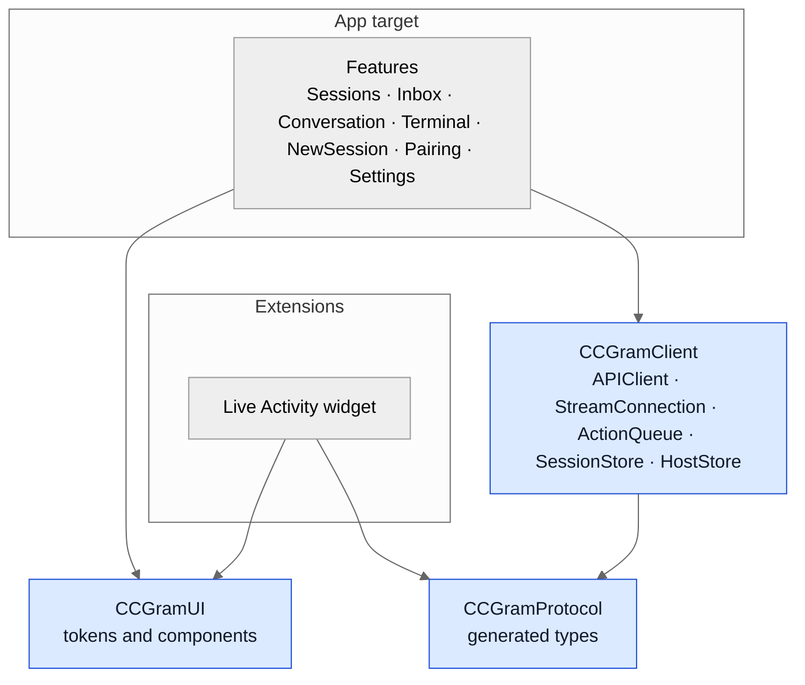
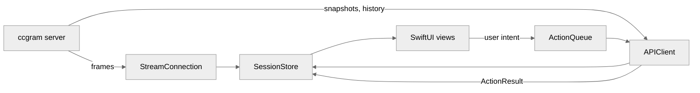
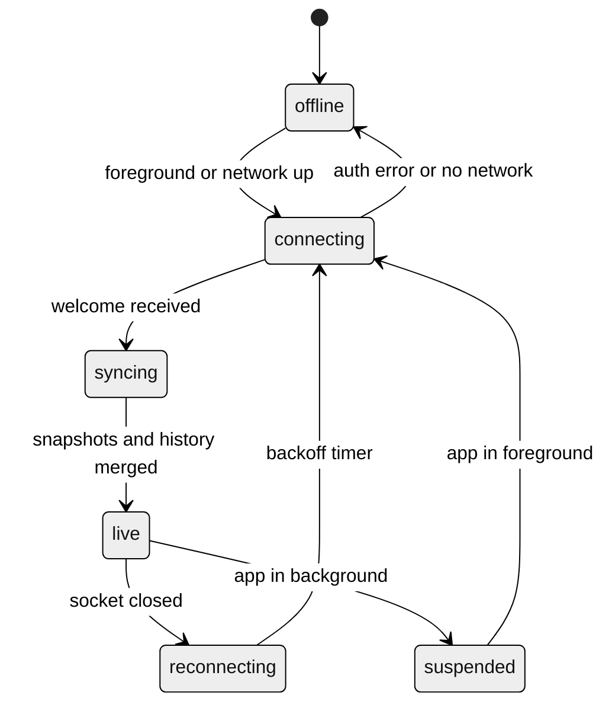
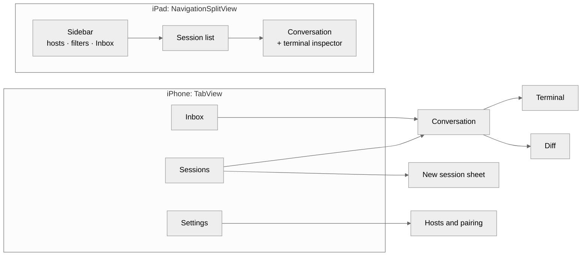
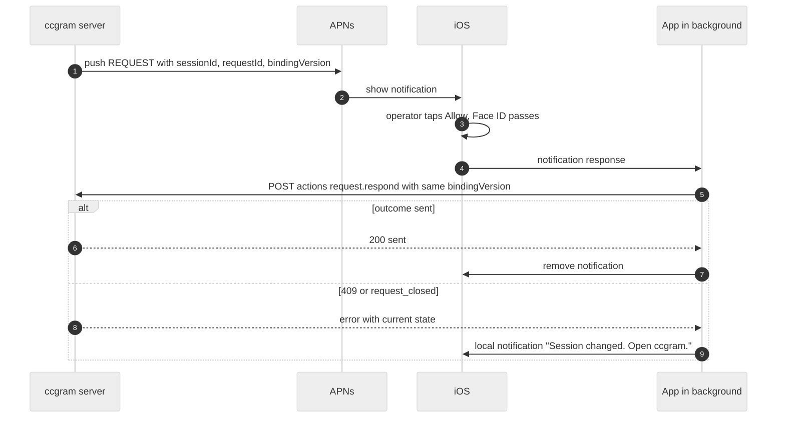

# Design: ccgram iOS app (iPhone and iPad)

| Field     | Value                                                                                      |
| --------- | ------------------------------------------------------------------------------------------ |
| Status    | Proposed                                                                                   |
| Date      | 2026-10-20                                                                                 |
| Related   | [Session service and protocol `ccgram/1`](2026-10-20-session-protocol.md)                  |
| Scope     | A native SwiftUI app for iPhone and iPad that is a client of `ccgram/1`                    |
| Non-goals | Android (P4), Mac app, cloud sync, public App Store release, an agent runtime on the phone |

**Reading guide.** This document uses stable IDs. Requirements are `IOS-Rnn`. Decisions are
`DI-nn`. The protocol types (`Session`, `Message`, `Part`, `Request`, `Action`) and all
field names come from the current [`protocol/v1/` schemas](../../protocol/v1/README.md).
The [client guide](../protocol/client-guide.md) defines retry, recovery, and capability
rules. This document does not repeat field lists. The design terms are in the
[glossary](2026-10-20-session-protocol.md#2-glossary).

**Style.** The text uses ASD-STE100 rules (strict mode, without a check against the official dictionary). Only
"must", "can", and "will" occur as modal verbs.

## Contents

1. [Summary](#1-summary)
2. [Requirements](#2-requirements)
3. [Decisions](#3-decisions)
4. [App architecture](#4-app-architecture)
5. [Connection lifecycle](#5-connection-lifecycle)
6. [Navigation](#6-navigation)
7. [Screens](#7-screens)
8. [Components](#8-components)
9. [Notifications and Live Activities](#9-notifications-and-live-activities)
10. [Visual design](#10-visual-design)
11. [iPad](#11-ipad)
12. [Empty and error states](#12-empty-and-error-states)
13. [Security on the device](#13-security-on-the-device)
14. [Tests](#14-tests)
15. [Distribution](#15-distribution)
16. [Phases](#16-phases)
17. [Open questions](#17-open-questions)

The implemented client contract and its current capability limits are documented in
[the protocol client guide](../protocol/client-guide.md).

## 1. Summary

The app shows all agent sessions on the Mac of the operator. It shows the messages of
each session, the open requests, and the live terminal. The operator can send prompts,
interrupt a run, answer requests, and send keys.

The app has one main purpose: to show which agent needs the operator now. Telegram shows
each session as a separate topic. The app shows all sessions on one screen and puts the
blocked sessions first.

The app is a thin client. The Mac holds all state. The app keeps only a cache, the device
token, and a queue of actions that wait for a response.

## 2. Requirements

| ID      | Requirement                                                                                                                                  |
| ------- | -------------------------------------------------------------------------------------------------------------------------------------------- |
| IOS-R01 | The operator can see each blocked session within one tap from the app start.                                                                 |
| IOS-R02 | The operator can answer a `hook` request from the session list, the Inbox, or a notification.                                                |
| IOS-R03 | The app never shows Approve or Deny for a `screen` request. It shows the terminal and the key bar.                                           |
| IOS-R04 | The app shows the true connection state at all times. It never shows old data as live data.                                                  |
| IOS-R05 | When the app comes to the foreground, it loads the open requests from the server before it shows them.                                       |
| IOS-R06 | Each sent message shows a "sent" mark. In a session with a transcript, it then shows a "delivered" mark (`action.updated` with `messageId`). |
| IOS-R07 | The app never sends an action two times with two different IDs. A retry uses the same action ID.                                             |
| IOS-R08 | The app cannot change the approval mode (protocol D-09).                                                                                     |
| IOS-R09 | All screens work with Dynamic Type, VoiceOver, Dark Mode, and Reduce Motion.                                                                 |
| IOS-R10 | The iPad layout shows the session list and the conversation at the same time.                                                                |

## 3. Decisions

| ID    | Decision                                                                                                                                  | Reason                                                                                                                                   |
| ----- | ----------------------------------------------------------------------------------------------------------------------------------------- | ---------------------------------------------------------------------------------------------------------------------------------------- |
| DI-01 | SwiftUI, with UIKit only for the terminal view.                                                                                           | Live Activities, actionable notifications, and iPad split views are native features.                                                     |
| DI-02 | Minimum version: iOS 26 and iPadOS 26.                                                                                                    | The system look comes with no fallback code, and there is one OS version to test. The operator uses an iPhone 14 Pro, which runs iOS 26. |
| DI-03 | Use SwiftTerm for the terminal, fed with full ANSI frames.                                                                                | ccgram reads screen captures, not a pty byte stream. A full frame works the same on all multiplexers.                                    |
| DI-04 | Generate the protocol types from `protocol/v1/` with `swift-openapi-generator`.                                                           | One schema for the server and the app (PROTO-R01).                                                                                       |
| DI-05 | The conversation view comes first. The terminal is a second view of the same session.                                                     | Terminal mirrors do not fit a phone screen. Messages and tool rows do.                                                                   |
| DI-06 | Approve and Deny buttons in the session list and in notifications, only for `hook` requests.                                              | A guess from the screen parser must not become an approval.                                                                              |
| DI-07 | Live Activity buttons open the app to the request. They do not approve.                                                                   | An approval needs Face ID and the full command on the screen.                                                                            |
| DI-08 | Use system controls and system materials.                                                                                                 | The app then takes the iOS 26 system look (Liquid Glass) with no custom code.                                                            |
| DI-09 | No third-party UI framework. Dependencies: SwiftTerm, swift-openapi-generator runtime, swift-snapshot-testing (tests only).               | Fewer updates to track. Each dependency has one clear job.                                                                               |
| DI-10 | Start with a free Apple ID. Xcode installs the app on the devices of the operator only. Buy the paid program only for push or TestFlight. | No cost before the app proves its value. Telegram stays the notification channel until then (section 15).                                |

## 4. App architecture

### 4.1 Packages



| Package or type    | Responsibility                                                                                        |
| ------------------ | ----------------------------------------------------------------------------------------------------- |
| `CCGramProtocol`   | Swift types generated from `protocol/v1/`. No logic.                                                  |
| `APIClient`        | HTTP calls. Adds the bearer token and, for Cloudflare mode, the Access headers.                       |
| `StreamConnection` | An `actor` that owns one WebSocket for each host. It does `hello`, resume, `subscribe`, and backoff.  |
| `SessionStore`     | An `@Observable` `@MainActor` class. It applies events to the state. Views read only from this store. |
| `ActionQueue`      | A persisted queue of actions without a response. It makes the action ID and keeps it for each retry.  |
| `HostStore`        | The list of paired hosts. Tokens are in the Keychain.                                                 |
| `CCGramUI`         | Design tokens (section 10) and shared components (section 8).                                         |

### 4.2 Data flow



Rules for `SessionStore`:

1. A `message.upsert` replaces the stored message only if its `revision` is higher.
2. A `request.closed` removes the request for any `reason`.
3. A `session.updated` with a new `bindingVersion` marks all drafts for this session.
   The composer then shows the new provider before the next send.
4. Ephemeral frames (`status.tick`, `terminal.frame`) change only view state. The store
   does not cache them.
5. On a changed `conversation.id` or `conversation.historyGeneration`, clear the
   cached messages of the old source and load history again. The server increments
   the generation when a transcript is replaced or truncated.
6. The store groups adjacent agent messages into one bubble (protocol D-05). The group is
   a view concern. The store keeps one item for each message ID.

### 4.3 Action queue

- The queue makes a UUID for each user intent. It stores the action on disk before the
  first send.
- If the network fails before a response, the queue sends the same action again with the
  same ID. The server returns the stored outcome (PROTO-R03).
- If the outcome is `unknown`, the queue does not send again. The UI shows the message
  "Delivery unknown. Check the terminal." with a button that opens the terminal view.
- If the outcome is `409 binding_conflict`, the queue drops the action. The UI shows the
  new provider and keeps the text in the composer.

## 5. Connection lifecycle



| State          | UI                                                                        |
| -------------- | ------------------------------------------------------------------------- |
| `offline`      | Banner "Mac offline". Data is dimmed. The last sync time shows.           |
| `connecting`   | Banner "Connecting…". Data is dimmed.                                     |
| `syncing`      | A thin progress line under the navigation bar. Actions wait in the queue. |
| `live`         | No banner.                                                                |
| `reconnecting` | Banner "Reconnecting…" and the time of the last sync.                     |
| `suspended`    | No UI. iOS closes the socket. Telegram reports events (APNs push in P3).  |

Backoff: 0.5 s, 1 s, 2 s, 5 s, then 10 s for each attempt. A new network path or a
foreground event resets the backoff.

When the app comes to the foreground, it does these steps:

1. Open the socket and send `hello` with the last `epoch` and `seq`.
2. If `welcome.resumed` is `false`, load `GET /v1/sessions` and the history of the open
   conversation.
3. Remove each request that is not in the new snapshot (IOS-R05).
4. Send the actions that are in the queue.

## 6. Navigation



- The Inbox tab has a badge with the number of open requests.
- A notification tap opens the Conversation of its session, scrolled to the request.
- Deep link format: `ccgram://<host>/s/<sessionId>` and `ccgram://<host>/s/<sessionId>/r/<requestId>`.

## 7. Screens

### 7.1 Sessions

```
┌─────────────────────────────────────┐
│ Sessions                  gaia ▾  + │
├─────────────────────────────────────┤
│ NEEDS YOU                           │
│ ⚠ ccgram          Claude     2m     │
│   Bash  rm -rf build/               │
│   [ Deny ]              [ Allow ]   │
├─────────────────────────────────────┤
│ WORKING                             │
│ ↻ api             Codex      3m     │
│   Running tests                     │
│ ↻ infra           Gemini     40s    │
│   Edit main.tf                      │
├─────────────────────────────────────┤
│ DONE                                │
│ ✓ docs            Claude     12m    │
│   "Done. Updated 3 files."          │
├─────────────────────────────────────┤
│ IDLE                                │
│ ○ shell           Shell      1h     │
└─────────────────────────────────────┘
```

- Sections in this order: Needs you, Working, Done, Idle, Dead. An empty section does not show.
- A row shows: the status symbol, the title, the provider, the relative time, and one line
  of detail. The detail is the request summary, the status line, or the last agent text.
- A row with a `hook` request shows Deny and Allow (DI-06). Allow asks for Face ID first.
- A row with a `screen` request shows "Open terminal" in place of the two buttons.
- Swipe actions: Interrupt (leading), Close (trailing, needs confirmation).
- The host picker in the title shows when more than one host is paired.
- Pull to refresh loads `GET /v1/sessions` again.

### 7.2 Inbox

```
┌─────────────────────────────────────┐
│ Inbox (2)                           │
├─────────────────────────────────────┤
│ ccgram · Claude              2m     │
│ Run a shell command                 │
│ ┌─────────────────────────────────┐ │
│ │ rm -rf build/                   │ │
│ └─────────────────────────────────┘ │
│ cwd ~/Workspace/ccgram              │
│ [ Deny ] [ Allow once ] [ Session ] │
├─────────────────────────────────────┤
│ infra · Gemini               9m     │
│ Which region?                       │
│ ( ) eu-west-1  ( ) us-east-1        │
│ [ Answer ]                          │
└─────────────────────────────────────┘
```

- The Inbox lists all open requests of all sessions, oldest first.
- The list comes from server state. It does not come from notifications (IOS-R05).
- A card shows the full command in monospace. The app never truncates a command. A long
  command scrolls in its box.
- For a `question` request, the card shows controls from `responseSchema`: single choice,
  many choices, or free text.

### 7.3 Conversation

```
┌─────────────────────────────────────┐
│ ‹ ccgram       Claude ↻   [Term]    │
│ feature/mobile · ~/Workspace/ccgram │
├─────────────────────────────────────┤
│ You                                 │
│ Run the tests and fix failures. ✓✓  │
│                                     │
│ Claude                              │
│ I will run the tests first.         │
│ ▸ ✓ Read   3 files            0.4s  │
│ ▸ ✓ Shell  go test ./...      12s   │
│ ▸ ✗ Shell  go vet ./...       2s    │
│ ▸ ✓ Edit   server.go     +12 −3     │
│ ▸ Thinking                          │
├─────────────────────────────────────┤
│ ⚠ Allow: Bash rm -rf build/         │
│ [ Deny ] [ Allow once ] [ Session ] │
├─────────────────────────────────────┤
│ [+] Message Claude…        [ ■ ]    │
└─────────────────────────────────────┘
```

- The header shows the title, the provider, the status symbol, the branch, and the cwd.
  The `[Term]` button opens the terminal view.
- A user message shows ✓ for `sent` and ✓✓ for delivered (IOS-R06).
- Tool parts show as one-line rows (section 8.2). A tap opens the full input and output.
- The approval card stays above the composer while a request is open. A scroll cannot
  hide the card.
- The send button changes to a Stop button (■) while the status is `working`. Stop sends
  `run.interrupt`.
- New messages scroll the view only when the view is at the bottom. Otherwise a
  "New messages ↓" pill shows.
- History loads in pages of 50 when the operator scrolls to the top.

### 7.4 Terminal

```
┌─────────────────────────────────────┐
│ ‹ ccgram  Terminal   pane ▾  [Input]│
├─────────────────────────────────────┤
│ $ go test ./...                     │
│ ok   ccgram/api      0.8s           │
│ FAIL ccgram/core     1.1s           │
│ ...                                 │
│                                     │
├─────────────────────────────────────┤
│ Esc Tab Ctrl ↑ ↓ ← → ^C ↵ / |       │
└─────────────────────────────────────┘
```

- The view is read-only by default. The `[Input]` toggle shows the keyboard and the key bar.
- A key on the key bar sends `terminal.key`. Text from the keyboard sends `terminal.paste`.
- The app sends `terminal.watch` when the view opens and `terminal.unwatch` when it closes.
- Pinch changes the font size. The size persists for each session.
- The pane picker shows when `panes` has more than one item.
- CAUTION: In a shell session, `terminal.paste` text runs as a command after ↵. The input
  field shows "Types into the terminal" as placeholder text.

### 7.5 New session

- Fields: host, directory (from favorites and recent directories), worktree toggle (only
  for an eligible git repository), provider, and approval mode.
- The approval mode list does not contain the YOLO mode (IOS-R08).
- The app sends `POST /v1/sessions`. It opens the new conversation when the response arrives.

### 7.6 Hosts and pairing

1. Run `ccgram pair` on the Mac.
2. Tap "Add host" in Settings.
3. Scan the QR code.
4. Make sure that the host name and the fingerprint on the phone match the Mac.
5. Tap "Pair".

The app shows the error text from the server for a failed pairing. Examples: "Code
expired. Run `ccgram pair` again." and "Host not reachable. Check Tailscale on this phone."

## 8. Components

### 8.1 Part renderers

| Part type  | Component      | Behavior                                                                                |
| ---------- | -------------- | --------------------------------------------------------------------------------------- |
| `text`     | `MarkdownText` | Renders Markdown with `AttributedString`. Code blocks use monospace with a copy button. |
| `thinking` | `ThinkingRow`  | Collapsed by default. One line: "Thinking". A tap shows the text in secondary color.    |
| `tool`     | `ToolRow`      | One line. See section 8.2.                                                              |
| `image`    | `ImageThumb`   | Thumbnail. A tap opens a full-screen viewer with zoom.                                  |
| `file`     | `FileChip`     | Name and size. A tap opens Quick Look.                                                  |
| `notice`   | `NoticeBanner` | Inline banner. Color from `level`.                                                      |
| unknown    | `UnknownPart`  | "Unsupported content" in secondary text. The app does not fail (PROTO-R06).             |

### 8.2 Tool row

```
▸ ✓ Shell  go test ./...            12s
  │ │      │                         └ duration
  │ │      └ title (monospace, one line, middle truncation)
  │ └ status: ◌ pending, ↻ running, ✓ completed, ✗ failed
  └ expand
```

- The icon comes from the tool `kind`: `read` doc, `edit` pencil, `execute` terminal,
  `search` magnifier, `fetch` globe, `think` lightbulb, `other` gear.
- Adjacent `read` and `search` rows with the status `completed` merge into one row:
  "Read 3 files". A tap shows the list.
- An `edit` row with a `diff` shows a `+N −M` chip. A tap opens the diff view.
- A `failed` row uses the error color for the status symbol only. The row text stays the
  primary color.

### 8.3 Diff view

- iPhone: unified diff. iPad in landscape: a toggle for side-by-side diff.
- A long press on a line adds a comment. The comment shows as a chip above the composer:
  `server.go:42 — "Use the constant here"`. The next `message.send` contains the
  comments as text before the message.
- File list at the top when the diff has more than one file.

### 8.4 Approval card

- Content: request title, tool name, full command or file path in monospace, cwd, time open.
- Buttons come from `options`. A `reject_*` option uses the destructive style. The
  `allow_always` option is the last button, so a fast tap does not hit it.
- A tap on an allow option asks for Face ID (setting, on by default). Then it sends
  `request.respond`.
- After the tap, the card shows a spinner until `request.closed` arrives. If the outcome
  is `rejected` or `unknown`, the card shows the error and stays open.

### 8.5 Composer

- A multiline text field. Return adds a line on iPhone. ⌘↩ sends on iPad (section 11).
- `/` at the start opens a list of slash commands from `GET /v1/sessions/{id}/commands`.
- `[+]` adds photos or files. The app uploads each file with `POST /v1/uploads` before
  it sends the message.
- Dictation uses the system keyboard microphone. The app adds no speech code in v1.
- When the status is `working`, the field shows "Message queues after this turn". The
  message goes to the agent at once. The agent decides when to read it.
- When `bindingVersion` changed, the composer shows "Now: Codex" and needs one more tap.
- When a request is open, the composer shows "Sending dismisses the open request". A
  send then needs a confirmation and sets `dismissRequest` to `true`. On a permission
  prompt, a dismiss has the same effect as Deny. Without a confirmation, the app does
  not send (the server returns `409 request_open`).

## 9. Notifications and Live Activities

This section is phase P3. It needs the paid Apple Developer Program (DI-10). With a free
Apple ID, iOS gives no APNs push. Telegram then stays the notification channel.

### 9.1 Notification categories

| Category   | Trigger            | Actions                                      | Interruption level |
| ---------- | ------------------ | -------------------------------------------- | ------------------ |
| `REQUEST`  | `request.opened`   | Allow (`authenticationRequired`), Deny, Open | `time-sensitive`   |
| `QUESTION` | question request   | Reply (text input), Open                     | `time-sensitive`   |
| `DONE`     | turn ended         | Open                                         | `active`           |
| `DEAD`     | session died       | Open                                         | `passive`          |
| `ERROR`    | API or agent error | Open                                         | `active`           |

- The server builds the payload (see the
  [protocol design, section 11](2026-10-20-session-protocol.md#11-push-notifications-server-side)).
- `thread-id` is the session ID, so iOS groups the notifications of one session.
- There is no "allow all" action.
- A `REQUEST` notification with a `screen` source has only Open (DI-06).

### 9.2 Answer from a notification



### 9.3 Live Activities

- The operator starts a Live Activity from the Conversation menu: "Follow on Lock Screen".
  A setting can start it for each prompt that the operator sends from the app.
- Static data: session ID, title, provider.
- Dynamic data: status, detail line, start time of the run, open request title.
- Compact view (Dynamic Island): provider glyph and status symbol. Elapsed time on the trailing side.
- Expanded view: title, current tool line, elapsed time, and an "Open" button. When a
  request is open, the button text is "Review request" (DI-07).
- The server updates the activity through APNs push tokens. It sends an update only when
  the status changes or a request opens. It never sends `status.tick` data.
- The activity ends when the session is `idle` or `dead` for 15 minutes, or at the 8-hour
  system limit.

## 10. Visual design

### 10.1 Principles

1. **Triage first.** The first screen answers the question "What needs me?".
2. **Calm while working.** A working agent shows motion in one small symbol only. Long
   output stays collapsed.
3. **Exact where it matters.** Commands, paths, and diffs use monospace and are never
   truncated in an approval.
4. **System first.** Use system fonts, system colors, SF Symbols, and system materials (DI-08).

### 10.2 Status tokens

Each status has a color and a symbol. The app never uses color alone.

| Status    | Color token       | System color     | SF Symbol                     | Motion                           |
| --------- | ----------------- | ---------------- | ----------------------------- | -------------------------------- |
| `working` | `status.working`  | `.blue`          | `arrow.triangle.2.circlepath` | Rotate (off with Reduce Motion)  |
| `blocked` | `status.blocked`  | `.orange`        | `exclamationmark.circle.fill` | One pulse when the request opens |
| `done`    | `status.done`     | `.green`         | `checkmark.circle.fill`       | None                             |
| `idle`    | `status.idle`     | `.secondary`     | `circle`                      | None                             |
| `dead`    | `status.dead`     | `.red`           | `xmark.octagon.fill`          | None                             |
| `unknown` | `status.unknown`  | `.tertiaryLabel` | `questionmark.circle`         | None                             |
| starting  | `status.starting` | `.secondary`     | `hourglass`                   | None                             |

A `screen` status source shows the symbol with lower opacity (0.6).

### 10.3 Typography

| Use                          | Style                                           |
| ---------------------------- | ----------------------------------------------- |
| Screen titles                | `.largeTitle`, system default                   |
| Session row title            | `.headline`                                     |
| Row detail, timestamps       | `.subheadline`, `.secondary`                    |
| Message text                 | `.body`                                         |
| Commands, paths, tool titles | `.body.monospaced()` or `.callout.monospaced()` |
| Diff and terminal            | SF Mono, fixed size, pinch to change            |

All text styles scale with Dynamic Type. The terminal and the diff have their own zoom
because a fixed grid does not reflow.

### 10.4 Color, space, and shape

- Backgrounds: `systemBackground` and `secondarySystemBackground`. The terminal uses pure
  black in Dark Mode and `systemBackground` in Light Mode.
- Diff colors: green and red at 15 % opacity for the line background, and the full color
  for the `+` and `−` gutter signs. Make sure that the contrast ratio is 4.5:1 or more.
- Spacing scale: 4, 8, 12, 16, 24 points.
- Corner radius: 12 points for cards, 8 points for chips.
- The approval card and the composer use `.regularMaterial`.
- Provider glyphs are monochrome and use the label color. The app does not use a
  provider color, so status color stays the only color signal.

### 10.5 Haptics

| Event                                   | Haptic                  |
| --------------------------------------- | ----------------------- |
| A request opens while the app is open   | `.warning` notification |
| A tap on Allow or Deny                  | `.impact(.light)`       |
| A turn ends in the open session         | `.success` notification |
| An action fails (`rejected`, `unknown`) | `.error` notification   |
| Message stream or status ticks          | None                    |

### 10.6 Accessibility

- VoiceOver label for a session row: "<title>, <provider>, <status>, <detail>". Example:
  "ccgram, Claude, blocked, permission request: Bash rm -rf build".
- Approval buttons have hints: "Allows this command once".
- Each tap target is 44 × 44 points or more. This includes the key bar.
- Reduce Motion stops the rotation of the `working` symbol.

## 11. iPad

```
┌────────────┬──────────────────┬─────────────────────────────┬────────────┐
│ Hosts      │ Sessions         │ ccgram · Claude ↻           │ Terminal   │
│ ● gaia     │ ⚠ ccgram   2m    │                             │ $ go test  │
│ ○ studio   │ ↻ api      3m    │ messages and tool rows      │ ok ...     │
│            │ ↻ infra    40s   │                             │ FAIL ...   │
│ Filters    │ ✓ docs     12m   │ ⚠ approval card             │            │
│ Inbox (2)  │                  │ [ composer ]                │ key bar    │
└────────────┴──────────────────┴─────────────────────────────┴────────────┘
```

- `NavigationSplitView` with three columns: sidebar, session list, conversation.
- The terminal shows in an `.inspector`. The operator can show or hide it.
- In Split View and Slide Over, the layout falls back to two columns, then to the iPhone stack.
- Pointer: hover shows the full title and cwd of a row.

| Shortcut  | Action                     |
| --------- | -------------------------- |
| ⌘↩        | Send                       |
| ⌘.        | Interrupt                  |
| ⌘[ and ⌘] | Previous and next session  |
| ⌘1 to ⌘9  | Session 1 to 9 in the list |
| ⌘N        | New session                |
| ⇧⌘Y       | Allow once (open request)  |
| ⇧⌘D       | Deny (open request)        |
| ⌘T        | Show or hide the terminal  |
| ⌘K        | Session search             |

The app registers each shortcut with `.keyboardShortcut`, so the ⌘ overlay lists it.

## 12. Empty and error states

Each state gives one fact and one next step.

| State                     | Text                                                                   | Action button         |
| ------------------------- | ---------------------------------------------------------------------- | --------------------- |
| No host                   | "No Mac is paired. Run `ccgram pair` on your Mac."                     | Add host              |
| Paired, no sessions       | "No agent sessions on gaia. Start one on the Mac or here."             | New session           |
| Host not reachable        | "gaia is not reachable. Check Tailscale on this phone and on the Mac." | Retry                 |
| Token revoked             | "This phone is no longer paired with gaia."                            | Pair again            |
| Cloudflare Access refused | "Cloudflare Access refused the request. Check the service token."      | Edit host             |
| Session dead              | "The terminal for this session closed."                                | Resume (if supported) |
| History limit             | "Older output is not available for shell sessions."                    | None                  |
| Delivery unknown          | "Delivery unknown. Check the terminal."                                | Open terminal         |
| Binding conflict          | "This pane now runs Codex. Send to Codex?"                             | Send / Cancel         |

## 13. Security on the device

- The device token and the Cloudflare Access service token are in the Keychain with
  `kSecAttrAccessibleAfterFirstUnlockThisDeviceOnly`. A Keychain access group shares
  them with the Live Activity extension.
- An approval needs Face ID or the passcode (setting, on by default). Notification actions
  use `authenticationRequired`.
- The app shows the server fingerprint from the QR code on the host screen.
- The app has no control that raises the approval mode (IOS-R08).
- The app keeps no transcript on disk outside the system cache. A setting clears the cache.

## 14. Tests

| Level      | What                                                                                           | Tool                   |
| ---------- | ---------------------------------------------------------------------------------------------- | ---------------------- |
| Protocol   | Decode each fixture in `protocol/v1/fixtures/`. Encode each action and compare to the fixture. | XCTest                 |
| Store      | Event sequences: resume, gap, revision order, request close reasons, binding conflict.         | XCTest                 |
| Queue      | Retry with the same ID, `unknown` stops retry, `409` drops the action.                         | XCTest                 |
| Components | Snapshot images in Light, Dark, and the largest Dynamic Type size.                             | swift-snapshot-testing |
| UI flow    | Pair, list, open, send, answer, and resume against a fake server that replays fixtures.        | XCUITest               |

Regression cases from user reports about other apps:

1. A request in the snapshot that the app never showed. The test expects the request in the Inbox.
2. A request that closed while the app was in the background. The test expects no ghost card.
3. A "working" symbol that stays after a resume. The test expects the status from the new snapshot.
4. An empty session list after pairing. The test expects the list or the "no sessions" state, never a blank screen.
5. A message without a "delivered" mark after `action.updated`. The test expects ✓✓.
6. A shell session message. The test expects ✓ only and no wait for ✓✓.

## 15. Distribution

Distribution has two stages (DI-10). A public App Store release is not in scope.

**Stage 1: free Apple ID (P2a and P2b).**

- Xcode signs the app with the personal team of the operator and installs it on the
  iPhone and the iPad over USB or Wi-Fi.
- The provisioning profile stops after 7 days. Then the app does not open until Xcode
  installs it again. The cache and the Keychain items stay.
- Personal teams have no Push Notifications and no iCloud capability. The app uses
  neither in stage 1.
- The bundle ID contains the personal team ID, so it is unique to the operator.

**Stage 2: paid Apple Developer Program (P3).** The operator buys it when one of these
becomes necessary:

- Push notifications and Live Activity updates from the Mac (section 9).
- A build that does not stop after 7 days, through TestFlight.
- Then the operator gives the APNs `.p8` key to ccgram on the Mac (protocol section 11).

The 7-day limit comes from developer reports, not from an Apple page. The push limit comes
from an Apple engineer on the developer forums. Check both against current Apple
documentation before stage 1.

## 16. Phases

| Phase | Scope                                                                                  | Exit criteria                                                                                |
| ----- | -------------------------------------------------------------------------------------- | -------------------------------------------------------------------------------------------- |
| P2a   | Pairing, Sessions, Conversation (read only), Terminal (read only), connection states.  | The app shows the same sessions and messages as Telegram. All protocol and store tests pass. |
| P2b   | Composer, Stop, Inbox, approval card, key bar, New session, iPad layout and shortcuts. | The operator does one full day of work from the app. No regression case fails.               |
| P3    | Notifications, notification actions, Live Activities, Cloudflare Access mode.          | The operator answers a permission request from the Lock Screen.                              |
| P4    | Android client on the same schema.                                                     | Out of scope for this document.                                                              |

P2a needs the protocol phase P1. P2a and P2b use a free Apple ID. P3 needs the paid
program (DI-10) and the server push module (protocol section 11).

## 17. Open questions

1. **File completion with `@`.** This needs a new endpoint for file names in the cwd. Decide in P2b.
2. **Many hosts on one screen.** v1 shows one host at a time with a picker. A merged list
   of all hosts is an option for P3.
