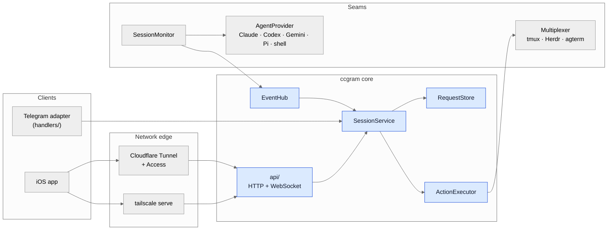
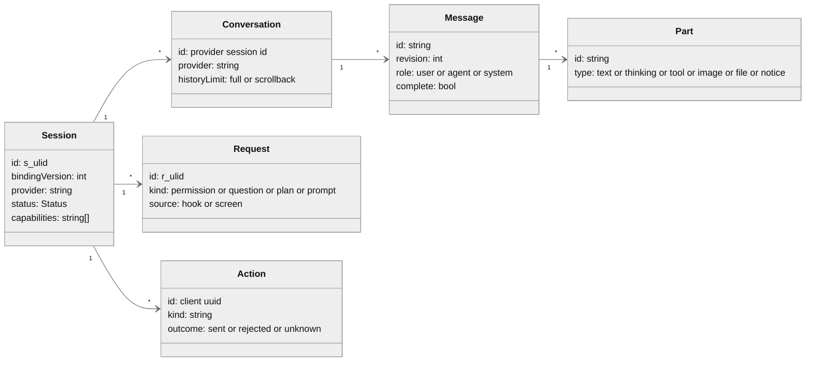
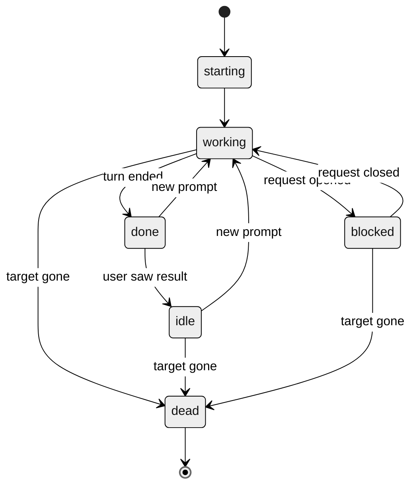
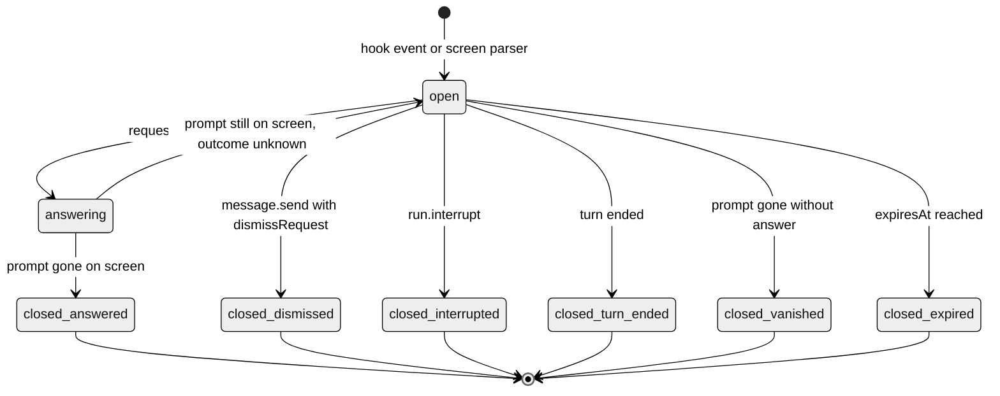
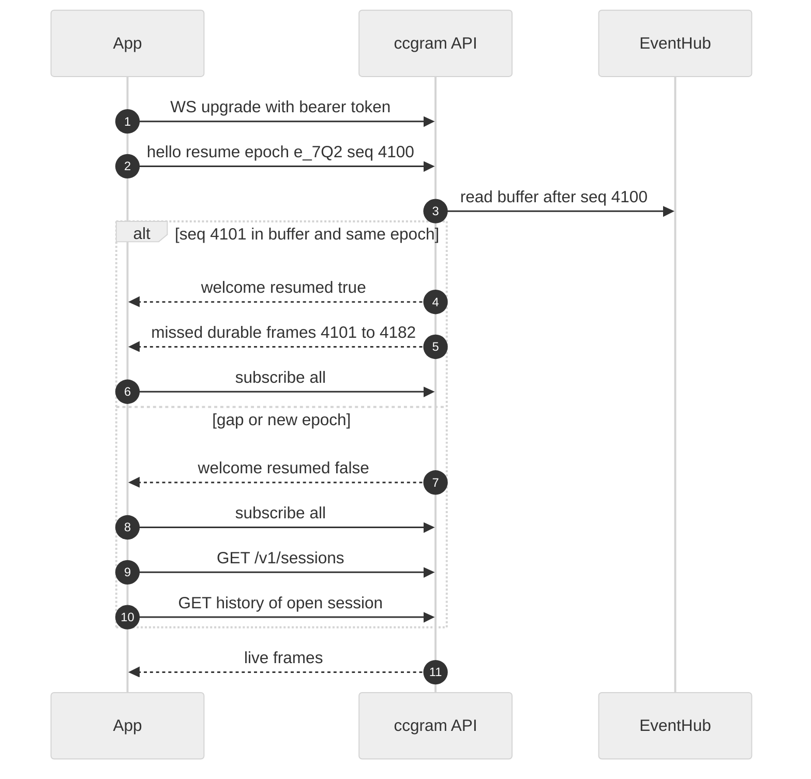
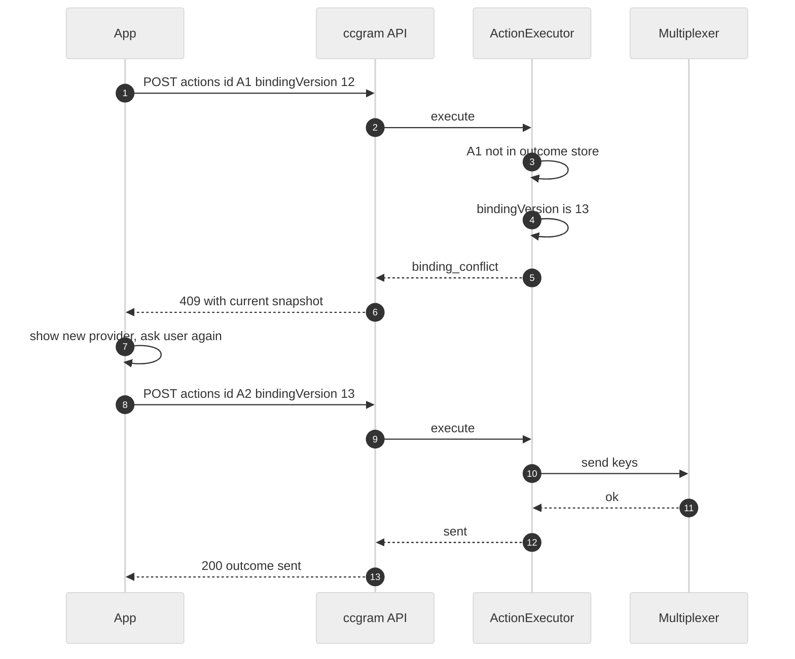
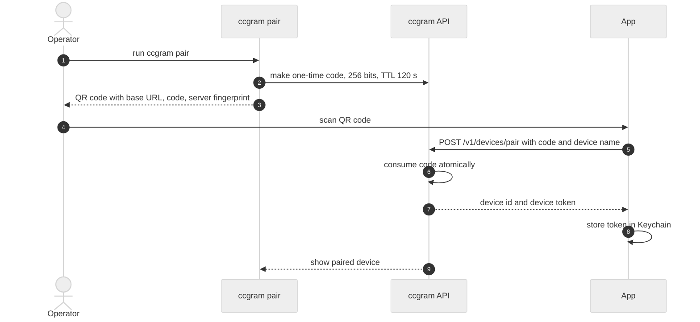

# Design: session service and protocol `ccgram/1`

| Field     | Value                                                                                |
| --------- | ------------------------------------------------------------------------------------ |
| Status    | Shared core and `ccgram/1` implemented; later client and runtime phases remain planned |
| Date      | 2026-10-20                                                                           |
| Related   | [iOS app design](2026-10-20-ios-app.md)                                              |
| Scope     | Core changes in ccgram, and the wire protocol `ccgram/1` for remote clients          |
| Non-goals | Cloud relay, user accounts, message database, new agent runtime, Android client (P4) |

**Reading guide.** This document uses stable IDs. Requirements are `CORE-Rnn` and
`PROTO-Rnn`. Decisions are `D-nn`. Core changes are `C-nn`. Phases are `P0` to `P4`.
Plans, reviews, and agents must cite these IDs. The [iOS app design](2026-10-20-ios-app.md)
uses these IDs for design requirements. The current wire contract is
[`protocol/v1/`](../../protocol/v1/README.md), with client behavior in the
[protocol client guide](../protocol/client-guide.md). This document records the
design baseline and planned phases. Where it differs from the implementation,
the schemas and [implementation guide](../protocol/implementation.md) take precedence.

**Style.** The text uses ASD-STE100 rules (strict mode, without a check against the official dictionary). The
words "must", "can", and "will" have their usual meaning. The text uses no other modal verbs.

**Implementation:** The shared Telegram/mobile core, wire schemas, and tests are in place. See
[protocol documentation](../protocol/README.md) for the current contract and
[implementation boundary](../protocol/implementation.md) for corrections to this
proposal, including durable delivery checkpoints and trusted local actions. APNs and headless mode remain
outside this implementation.

## Contents

1. [Summary](#1-summary)
2. [Glossary](#2-glossary)
3. [Current state](#3-current-state)
4. [Requirements](#4-requirements)
5. [Decisions](#5-decisions)
6. [Architecture](#6-architecture)
7. [Domain model](#7-domain-model)
8. [Core changes](#8-core-changes)
9. [Protocol `ccgram/1`](#9-protocol-ccgram1)
10. [Security](#10-security)
11. [Push notifications (server side)](#11-push-notifications-server-side)
12. [Schema and conformance](#12-schema-and-conformance)
13. [Phases](#13-phases)
14. [Risks and open questions](#14-risks-and-open-questions)
15. [Prior art](#15-prior-art)

## 1. Summary

This section describes the proposal's starting point. The shared core and full
Telegram cutover are implemented. The native iOS app remains planned.

ccgram controls AI coding agents that run in terminal sessions (tmux, Herdr, agterm).
Today, Telegram is the only client. Telegram handlers own a part of the session logic.

This design moves that logic into one service, `SessionService`. The service does not
know about Telegram. Telegram and a native iOS app become two clients of the service.
The iOS app uses a new wire protocol, `ccgram/1` (JSON over HTTPS and WebSocket).

ccgram attaches to agent sessions that the user started in a terminal. It does not
start the agent through a wrapper. It does not run a second copy of the agent through
an SDK. Thus the phone and the Mac use the same process, the same sandbox, and the same
permission rules. This property is the main difference from Happy (see D-01).

## 2. Glossary

| Term               | Meaning                                                                                                                                                |
| ------------------ | ------------------------------------------------------------------------------------------------------------------------------------------------------ |
| Control session    | One terminal context that ccgram controls: one multiplexer window or agent target. Public ID `s_<ulid>`. In the protocol, the type name is `Session`.  |
| Target             | The internal locator of a control session in the multiplexer: a tmux `@id`, an opaque Herdr target, or an agterm session UUID. Clients never see it.   |
| Conversation       | One agent transcript inside a control session. The ID is the provider session ID. `/clear` or a new agent in the same pane starts a new conversation.  |
| Message            | One transcript entry in protocol form. It has an ID, a revision, a role, and parts.                                                                    |
| Part               | One content block in a message: text, thinking, tool, image, file, or notice.                                                                          |
| Request            | An open question from the agent to the user: a permission, a question, or a plan approval. A request stays open until an answer or a change closes it. |
| Action             | One operation that a client asks for: send a message, interrupt, answer a request, send keys, and more.                                                |
| `bindingVersion`   | An integer for each control session. It increases when the provider, the conversation, or the target changes.                                          |
| Durable event      | An event that the server keeps in a replay buffer. It has a sequence number (`seq`).                                                                   |
| Ephemeral event    | An event that the server does not replay: terminal frames and presence data.                                                                           |
| Epoch              | A random ID that changes each time the server starts. A new epoch makes all old `seq` values invalid.                                                  |
| Durable consumer   | An in-process event consumer that must receive each event (Telegram). The transcript watermark waits for durable consumers.                            |
| Ephemeral consumer | An event consumer that can miss events and recover through the history API (WebSocket clients).                                                        |
| Operator           | The one person who owns this ccgram instance. All paired devices act as the operator (D-11).                                                           |
| Device             | One paired client installation. It has a device token that the operator can revoke.                                                                    |

## 3. Current state

The facts below are from the code on 2026-10-20 (commit `0b8ae82`).

- `session_monitor.py` has one message callback (`set_message_callback`).
  `bootstrap.py` connects this callback to Telegram delivery (`handle_new_message`).
- Monitor watermarks advance through the delivery receipts of the Telegram queue
  (`session_monitor.py` `_delivery_receipts`, `live_session_state.get_delivery_watermark`).
- `transcript_parser.ParsedEntry.text` contains text that is already formatted for
  Telegram. `ParsedEntry` has no entry ID.
- Transcript entries have native IDs in most providers. Claude uses `uuid`.
  Gemini and Pi use `id`. Current Codex `response_item` lines carry `payload.id`.
  Older Codex lines and some entry types have no ID.
- The interactive prompt state (`handlers/interactive/interactive_ui.py`,
  `_interactive_mode`) uses the key `(user_id, thread_id, chat_id)`. This key is a
  Telegram identity, not a window.
- The safe text delivery is in `handlers/text/text_handler.py`.
  `_forward_message` dismisses an open prompt, then makes sure that the prompt is gone,
  then sends the text (`_dismiss_interactive_prompt`). Two incidents in September 2026
  caused this logic.
- `handlers/hook_events.py` receives `PermissionRequest` and `PreToolUse` events and
  ignores them. The interactive UI comes from `Notification` hooks and screen parsing.
- `handlers/callback_helpers.py:user_owns_window` uses the Telegram user ID.
- `handlers/telegram_origin.py:send_telegram_to_window` sends text to a window for a
  Telegram user.
- The Mini App server (`miniapp/server.py`, aiohttp) listens on `127.0.0.1:8765` by
  default. Its auth key comes from the bot token (`miniapp/auth.py`).
- `bootstrap_application` runs as the PTB `post_init` hook. Thus ccgram cannot run
  without Telegram.
- `window_resolver.resolve_stale_ids` maps window IDs again after a tmux restart.

### Drift from current rules

- `.claude/rules/topic-architecture.md` says that topics are the session list and that
  there is no central session list. This design adds a central list
  (`GET /v1/sessions`) on purpose. Telegram topics stay as the Telegram view of that list.
- When the team implements this design, these files must change:
  `.claude/rules/architecture.md`, `.claude/rules/topic-architecture.md`,
  `.claude/rules/message-handling.md`, and `docs/architecture.md`.

## 4. Requirements

### Core

| ID       | Requirement                                                                                                        |
| -------- | ------------------------------------------------------------------------------------------------------------------ |
| CORE-R01 | All actions go to the real pane of the user through the `Multiplexer` seam. ccgram has no SDK path and no wrapper. |
| CORE-R02 | After P0, Telegram output is the same as before. Snapshot fixtures prove this.                                     |
| CORE-R03 | A client can list a control session that has no Telegram topic.                                                    |
| CORE-R04 | The history API and the live stream give the same message ID and revision for the same transcript entry.           |
| CORE-R05 | A slow or disconnected remote client never stops Telegram delivery and never holds a watermark.                    |
| CORE-R06 | The safe text delivery rules apply to all clients, not only to Telegram.                                           |
| CORE-R07 | An open request is server state. The key is the control session, not a Telegram topic.                             |
| CORE-R08 | ccgram stores no copy of messages. Transcripts and the multiplexer are the sources of truth.                       |
| CORE-R09 | ccgram persists only small state: session IDs, devices, and action outcomes.                                       |

### Protocol

| ID        | Requirement                                                                                                            |
| --------- | ---------------------------------------------------------------------------------------------------------------------- |
| PROTO-R01 | A machine-readable schema is the source of truth for the protocol. Text in this document explains the schema.          |
| PROTO-R02 | After a disconnect, a client gets all missed durable events, or it gets a clear signal to load a new snapshot.         |
| PROTO-R03 | Each action has a client ID. The server never executes the same action ID two times.                                   |
| PROTO-R04 | If the server cannot know whether keys arrived in the pane, the outcome is `unknown`.                                  |
| PROTO-R05 | An action with an old `bindingVersion` fails with `409`. The response contains the current session snapshot.           |
| PROTO-R06 | An added field or event type does not change the major version. Clients ignore unknown fields and unknown event types. |
| PROTO-R07 | The server listens only on the loopback interface. A tunnel or Tailscale gives remote access.                          |

## 5. Decisions

| ID   | Decision                                                                                           | Reason                                                                                                                    |
| ---- | -------------------------------------------------------------------------------------------------- | ------------------------------------------------------------------------------------------------------------------------- |
| D-01 | Attach to the sessions of the user. Do not wrap or start the agent.                                | One execution path. The Happy remote mode runs the agent through an SDK and skipped the sandbox (slopus/happy#1894).      |
| D-02 | Define an own protocol. Use names from ACP, Codex app-server, and OpenCode where they fit.         | No current protocol covers a live TUI with terminal keys. ACP, AG-UI, and Codex app-server all own a headless agent.      |
| D-03 | Use HTTP for queries and actions. Use WebSocket only for events.                                   | One path for each operation. Actions get normal HTTP status codes.                                                        |
| D-04 | Send messages and parts as full replacements (`upsert`). Use no text deltas and no JSON Patch.     | Transcripts contain complete entries. A full replacement is easy to merge and easy to test.                               |
| D-05 | Make one protocol message for each transcript entry. Clients group adjacent agent messages.        | Claude writes one API response as many JSONL lines with the same `message.id`. A message for each entry keeps IDs stable. |
| D-06 | Answer a request with keys, then read the screen again to make sure that the prompt closed.        | This is the same path that Telegram uses. A hook that waits for the answer is a later option (see section 14).            |
| D-07 | Give durable events a `seq` and keep them in a ring buffer. Do not replay ephemeral events.        | A client can resume after a short disconnect. A long gap falls back to snapshot and history.                              |
| D-08 | Use `tailscale serve` as the default network. Allow Cloudflare Tunnel only with Cloudflare Access. | No relay to operate. Both give TLS. The tunnel is public, so it needs a second auth layer.                                |
| D-09 | Remote clients cannot raise the approval mode (no YOLO from the phone).                            | Claude Code mobile has the same rule. A stolen phone must not remove all permission prompts.                              |
| D-10 | Make the session ID in ccgram (`s_<ulid>`) and persist it. Do not use the target as the ID.        | tmux IDs change after a restart. Herdr targets are long opaque strings.                                                   |
| D-11 | In v1, all paired devices act as the one operator. They see all eligible sessions.                 | ccgram is a personal tool. Multi-user rules are an open question.                                                         |

## 6. Architecture

### Layers



Blue boxes are new. The Telegram adapter is in-process. It calls `SessionService`
directly and does not use the wire protocol.

### Module map

| Module (new or changed)                        | Responsibility                                                                                     |
| ---------------------------------------------- | -------------------------------------------------------------------------------------------------- |
| `session_service.py` (new)                     | The five public operations (section 8, C-05). Transport-neutral.                                   |
| `session_ids.py` (new)                         | Makes, persists, and resolves `s_<ulid>` IDs (C-06).                                               |
| `session_events.py` (new)                      | `EventHub`: fan-out, durable and ephemeral consumers, ring buffer, `seq` (C-04).                   |
| `actions.py` (new)                             | `ActionExecutor`: validation, binding check, window lock, safe delivery, outcome store (C-03).     |
| `request_store.py` (new)                       | Open requests for each control session (C-02).                                                     |
| `messages.py` (new)                            | Protocol `Message` and `Part` types and the entry-to-message builder (C-01).                       |
| `api/` (new)                                   | aiohttp routes for `ccgram/1`, device auth, pairing (section 9, 10).                               |
| `push/` (new, P3)                              | APNs sender and presence rules (section 11).                                                       |
| `providers/*` (changed)                        | Give structured parts and an entry key, not formatted text (C-01).                                 |
| `transcript_reader.py` (changed)               | Read delivery cursors and render canonical parts for Telegram.                                        |
| `handlers/` (changed)                          | Render parts for Telegram. Call `ActionExecutor` for all sends. Read requests from `RequestStore`. |
| `session_monitor.py`, `bootstrap.py` (changed) | Publish to `EventHub`. Wire Telegram as a durable consumer.                                        |

## 7. Domain model



### Identity rules

1. **Session ID.** `SessionIdRegistry` makes `s_<ulid>` the first time that ccgram sees
   an eligible target. It persists the ID in `state.json`. When `resolve_stale_ids` or
   an alias fold changes the target, the registry moves the ID to the new target.
2. **Message ID.** The ID is `{conversationId}/{entryKey}`. Clients treat it as opaque.
3. **Entry key.** Each provider has one function, `entry_key(entry, line_offset)`.
   This function returns the native ID of the entry. If the entry has no native ID, it
   returns `o{line_offset}`. The line offset is the byte offset of the first byte of the
   JSONL line. JSONL files are append-only, so this offset does not change.
4. **One builder.** The history API and the live stream must call the same builder,
   `build_messages(entries)`. Two builders will give different IDs (CORE-R04).
5. **Part ID.** The ID is `{messageId}#{index}`.
6. **Tool results.** The builder adds a tool result to the tool part of the original
   `tool_use` message, matched by `tool_use_id`. The tool result entry itself makes no
   message.
7. **Revision.** The revision is a pure function of the entries in the message: 1 plus
   the number of tool results that the builder added. The value does not come from a
   counter in memory. Thus the history API, the live stream, and a restarted server give
   the same revision for the same entries.
8. **Pairs across pages.** A history page can contain a `tool_use` entry without its
   result. For each open tool call on the page, the builder reads forward in the
   transcript to find the result. A per-conversation index (`tool_use_id` to result
   offset) makes this read fast. The monitor updates this index as it reads new lines.
9. **Binding version.** `bindingVersion` increases when the provider, the conversation,
   or the target of the control session changes.

### Session status



| Status     | Meaning                                                                                     |
| ---------- | ------------------------------------------------------------------------------------------- |
| `starting` | The target exists. The agent is not ready.                                                  |
| `working`  | The agent runs a turn.                                                                      |
| `blocked`  | One or more requests are open.                                                              |
| `done`     | The last turn ended. No client sent a message after that turn.                              |
| `idle`     | The agent waits for input. A client saw the last result.                                    |
| `dead`     | The target does not exist.                                                                  |
| `unknown`  | The source data is not sufficient. For scraped agents, the fallback is `working` or `idle`. |

The status object also has a `source` field: `hook`, `transcript`, `native`, or `screen`.
Clients can show a lower confidence for `screen`.

## 8. Core changes

Each change keeps Telegram behavior the same (CORE-R02). Each change has a fitness test.

### C-01 Structured parts and a Telegram renderer

- Providers return `Part` objects and an entry key. They do not return formatted text.
- `build_messages(entries)` in `messages.py` makes protocol messages. It pairs tool
  results with tool calls.
- Telegram formatting (`entity_formatting`, expandable quotes, `tool_batch`) moves into
  a renderer: `render_for_telegram(message) -> text`.
- **Order of work.** First, add snapshot tests for the current Telegram output of each
  provider. Then move one provider at a time. The snapshots must not change.
- **Risk.** This is the largest change. Telegram formatting has many edge cases.

### C-02 `RequestStore`

- `RequestStore` keeps open requests for each control session. The key is the session ID.
- `interactive_ui` becomes a Telegram view. It keeps only the map from a request ID to a
  Telegram message ID.
- A request has a `source`. A `hook` request comes from a hook payload, so its content
  is structured. A `screen` request comes from the terminal parser. It is a guess.
- **New work (P1).** `PermissionRequest` and `PreToolUse` with `AskUserQuestion` must
  make `hook` requests. Today `hook_events.py` ignores these events.
- Only `hook` requests have the `request.respond` capability. For a `screen` request,
  clients show the terminal and the key bar.



### C-03 `ActionExecutor`

- `ActionExecutor` is the only code that sends input to a pane for a client action.
- It holds one `asyncio.Lock` for each control session. Telegram and the phone cannot
  send at the same time to one pane.
- For each action, it does these steps:
  1. Read the outcome store. If the action ID is known, return the stored outcome.
  2. Compare `bindingVersion` with the current value. If they are different, return `409`.
  3. Read the current foreground process through `multiplexer.foreground()`. If the
     provider changed, return `409`.
  4. For `message.send`: if a request is open and `dismissRequest` is not `true`, return
     `409 request_open`. If `dismissRequest` is `true`, dismiss the prompt and read the
     screen again (the logic of `_dismiss_interactive_prompt`). If the prompt stays,
     return `rejected`. If the prompt is gone, close the request with the reason `dismissed`.
     On a permission prompt, a dismiss has the same effect as Deny.
  5. Send the input through the `Multiplexer` seam.
  6. Store the outcome and return it.
- Telegram-only steps stay in the handler: the typing action, the status message clear,
  the reaction, and the bash output capture.
- The Telegram adapter always sets `dismissRequest` to `true`. This keeps the current
  Telegram behavior (CORE-R02).
- `run.interrupt` uses a key sequence that the provider defines.

### C-04 `EventHub`

- `SessionMonitor` publishes to `EventHub`. It no longer calls one callback.
- Telegram registers as a durable consumer. It keeps its delivery receipts.
- The WebSocket API registers as an ephemeral consumer.
- The watermark waits only for durable consumers (CORE-R05). If no durable consumer
  exists (headless mode, P4), the watermark advances when the hub accepts the event.
- The hub gives each durable event a `seq`. It keeps the last 1000 durable events, or the
  events of the last 10 minutes, in a ring buffer. The smaller set applies.

### C-05 `SessionService`

The service has five operations. All clients use only these operations.

```python
class SessionService(Protocol):
    async def list_sessions(self) -> list[SessionSnapshot]: ...
    async def get_session(self, session_id: str) -> SessionSnapshot: ...
    async def history(self, session_id: str, cursor: str | None, limit: int) -> HistoryPage: ...
    def watch(self, session_ids: Collection[str] | None) -> AsyncIterator[Event]: ...
    async def execute(self, session_id: str, action: Action) -> ActionResult: ...
```

- `create_session` is a separate operation because no session ID exists yet. It reuses
  the current `/new` flow logic in `window_launch_service.launch_window`.
- The eligibility rule for `list_sessions` is the current rule: `WindowRef.topic_eligible`
  plus the monitored entries in `session_map.json`. The service adds no second rule.

### C-06 Session ID registry

- See identity rule 1 in section 7.
- Storage: a new map `session_ids` in `state.json`, from target to session ID.

### C-07 Headless runtime (P4)

- Move the startup steps of `bootstrap_application` out of the PTB lifecycle into a
  runtime that does not need Telegram.
- Telegram becomes an optional adapter. Config: `CCGRAM_TELEGRAM=off`.

### Fitness tests

| Test                                | Rule                                                                                                                                                                           |
| ----------------------------------- | ------------------------------------------------------------------------------------------------------------------------------------------------------------------------------ |
| `test_api_boundary.py`              | `api/` does not import `handlers/` or `telegram`.                                                                                                                              |
| `test_action_path.py`               | Handlers do not call `multiplexer.send*` for client input. They call `ActionExecutor`. An allow-list holds the migration exceptions.                                           |
| `test_message_identity.py`          | For each provider fixture, the history builder and the live builder give the same `(id, revision)` list. One fixture puts a page boundary between a `tool_use` and its result. |
| `test_telegram_render_snapshots.py` | The Telegram renderer output matches the snapshots taken before C-01.                                                                                                          |
| `test_protocol_fixtures.py`         | Server output matches the JSON Schema and the golden fixtures in `protocol/v1/`.                                                                                               |

## 9. Protocol `ccgram/1`

The schema files are the source of truth (PROTO-R01). This section explains them.

### 9.1 Transport and versions

- Base URL: `https://<host>/v1`. All bodies are JSON (UTF-8).
- Auth: the header `Authorization: Bearer <device token>` on each HTTP request and on the
  WebSocket upgrade.
- `GET /v1/meta` returns `{protocol: "ccgram/1", server, minClient, capabilities[]}`.
- The major version is in the path. An incompatible change makes `/v2`.
- Server capabilities are strings, for example `push.apns` and `terminal.view`. An
  omitted capability means "not supported" (from ACP).

### 9.2 HTTP endpoints

| Method and path                                 | Purpose                                                  |
| ----------------------------------------------- | -------------------------------------------------------- |
| `GET /v1/meta`                                  | Protocol version and server capabilities                 |
| `GET /v1/sessions`                              | All eligible sessions as `SessionSnapshot[]`             |
| `POST /v1/sessions`                             | Create a session (directory, provider, mode, worktree)   |
| `GET /v1/sessions/{id}`                         | One `SessionSnapshot` with its open requests             |
| `GET /v1/sessions/{id}/history`                 | One page of messages (section 9.6)                       |
| `POST /v1/sessions/{id}/actions`                | Execute one action (section 9.5)                         |
| `GET /v1/sessions/{id}/terminal?pane=`          | One ANSI screen capture                                  |
| `GET /v1/sessions/{id}/commands`                | Slash commands of the provider (from `command_catalog`)  |
| `POST /v1/uploads`                              | Upload a file. Returns a `file` reference for a message. |
| `POST /v1/devices/pair`                         | Exchange a one-time pairing code for a device token      |
| `GET /v1/devices` and `DELETE /v1/devices/{id}` | List and revoke devices                                  |
| `PUT /v1/devices/{id}/push`                     | Register APNs tokens (section 11)                        |
| `GET /v1/stream` (upgrade)                      | WebSocket event stream (section 9.4)                     |

### 9.3 Core types

`SessionSnapshot`:

```json
{
  "id": "s_01JC2Z8QF3",
  "bindingVersion": 12,
  "title": "ccgram",
  "host": "gaia-mbp",
  "cwd": "/Users/alexei/Workspace/ccgram",
  "gitBranch": "feature/mobile",
  "provider": "codex",
  "conversation": { "id": "019a1c2e", "historyLimit": "full" },
  "status": {
    "state": "working",
    "detail": "Running tests",
    "source": "transcript",
    "since": "2026-10-20T10:31:02Z"
  },
  "approvalMode": "default",
  "panes": [{ "id": "p0", "title": "claude", "active": true }],
  "openRequests": [],
  "capabilities": [
    "message.send",
    "run.interrupt",
    "request.respond",
    "terminal.view",
    "terminal.key",
    "session.close"
  ],
  "lastActivity": "2026-10-20T10:33:40Z"
}
```

`Message` and `Part`:

```json
{
  "id": "019a1c2e/o48213",
  "revision": 2,
  "conversationId": "019a1c2e",
  "role": "agent",
  "time": "2026-10-20T10:33:12Z",
  "complete": true,
  "actionId": null,
  "parts": [
    {
      "id": "019a1c2e/o48213#0",
      "type": "text",
      "text": "I will run the tests."
    },
    {
      "id": "019a1c2e/o48213#1",
      "type": "tool",
      "toolCallId": "call_7f",
      "name": "shell",
      "kind": "execute",
      "status": "completed",
      "title": "go test ./...",
      "input": { "command": "go test ./..." },
      "output": { "text": "ok  ./...  1.2s", "truncated": false },
      "diff": null
    }
  ]
}
```

| Part type  | Fields                                                                                                           |
| ---------- | ---------------------------------------------------------------------------------------------------------------- |
| `text`     | `text` (Markdown)                                                                                                |
| `thinking` | `text`                                                                                                           |
| `tool`     | `toolCallId`, `name`, `kind`, `status`, `title`, `input`, `output`, `diff` (`path`, `added`, `removed`, `patch`) |
| `image`    | `url` (a server path), `width`, `height`, `mime`                                                                 |
| `file`     | `url`, `name`, `size`, `mime`                                                                                    |
| `notice`   | `level` (`info`, `warning`, `error`), `text`. Examples: API error, compaction, session start.                    |

Tool `kind` values (from ACP): `read`, `edit`, `delete`, `move`, `search`, `execute`,
`think`, `fetch`, `other`. Tool `status` values: `pending`, `running`, `completed`, `failed`.

`Request`:

```json
{
  "id": "r_01JC2ZB1KM",
  "sessionId": "s_01JC2Z8QF3",
  "kind": "permission",
  "source": "hook",
  "title": "Run a shell command",
  "tool": {
    "name": "Bash",
    "kind": "execute",
    "input": { "command": "rm -rf build/" }
  },
  "options": [
    { "id": "allow", "label": "Allow", "kind": "allow_once" },
    {
      "id": "allow_session",
      "label": "Allow for this session",
      "kind": "allow_always"
    },
    { "id": "deny", "label": "Deny", "kind": "reject_once" }
  ],
  "responseSchema": null,
  "openedAt": "2026-10-20T10:34:00Z",
  "expiresAt": null
}
```

- `kind`: `permission`, `question`, `plan`, or `prompt` (a generic menu from the screen).
- Option `kind` (from ACP): `allow_once`, `allow_always`, `reject_once`, `reject_always`.
- `responseSchema` is a JSON Schema for a `question` request with free text or many choices.

### 9.4 WebSocket stream

Frame envelope (server to client):

```json
{
  "v": 1,
  "epoch": "e_7Q2",
  "seq": 4182,
  "class": "durable",
  "type": "message.upsert",
  "sessionId": "s_01JC2Z8QF3",
  "data": {}
}
```

Ephemeral frames have `"class": "ephemeral"` and no `seq`.

| Server frame       | Class     | `data`                                                                         |
| ------------------ | --------- | ------------------------------------------------------------------------------ |
| `welcome`          | control   | `epoch`, `seq` (latest), `resumed` (bool)                                      |
| `session.snapshot` | durable   | `SessionSnapshot`                                                              |
| `session.updated`  | durable   | Changed fields of `SessionSnapshot` plus `bindingVersion`                      |
| `session.removed`  | durable   | `reason`                                                                       |
| `message.upsert`   | durable   | `Message` (full replacement)                                                   |
| `request.opened`   | durable   | `Request`                                                                      |
| `request.closed`   | durable   | `requestId`, `reason`                                                          |
| `action.updated`   | durable   | `actionId`, `outcome`, `messageId` (set when the transcript shows the message) |
| `status.tick`      | ephemeral | `state`, `detail` (status line text)                                           |
| `terminal.frame`   | ephemeral | `pane`, `rows`, `cols`, `ansi`, `hash`                                         |

| Client frame       | `data`                                          |
| ------------------ | ----------------------------------------------- |
| `hello`            | `protocol`, optional `resume: {epoch, seq}`     |
| `subscribe`        | `sessionIds` (a list, or `"*"` for all)         |
| `terminal.watch`   | `sessionId`, `pane`, `intervalMs` (minimum 500) |
| `terminal.unwatch` | `sessionId`                                     |

`request.closed` reasons: `answered`, `dismissed`, `interrupted`, `turn_ended`, `vanished`, `expired`.
A request can close without an answer. Clients must remove it from the UI on any reason.

Resume rules:

1. If `resume.epoch` is the current epoch and the ring buffer has `seq + 1`, the server
   sends all missed durable frames. Then `welcome.resumed` is `true`.
2. If one of these conditions is false, `welcome.resumed` is `false`. Then the client must
   load `GET /v1/sessions` and the history of the open session again.
3. The client must subscribe before it loads history. Then it merges both sources by
   `(message.id, revision)`. The higher revision wins.



### 9.5 Actions

Request body:

```json
{
  "id": "5f39db61-8e61-49e1-b0ec-3ecb2a1a72b1",
  "bindingVersion": 12,
  "kind": "message.send",
  "data": { "text": "Run the tests again." }
}
```

| Action kind       | `data`                                                                    | Notes                                                          |
| ----------------- | ------------------------------------------------------------------------- | -------------------------------------------------------------- |
| `message.send`    | `text`, optional `files[]` (upload references), optional `dismissRequest` | A message to the agent. Safe delivery applies (C-03 step 4).   |
| `run.interrupt`   | none                                                                      | Key sequence from the provider.                                |
| `request.respond` | `requestId`, `optionId` or `answer`                                       | Only for `hook` requests.                                      |
| `terminal.key`    | `keys[]` (tmux key names: `Escape`, `C-c`, `Up`)                          | Raw keys.                                                      |
| `terminal.paste`  | `text`                                                                    | Literal text into the terminal. It can run as a shell command. |
| `session.close`   | none                                                                      | Kills the target.                                              |
| `session.resume`  | `conversationId`                                                          | Only when the provider supports resume.                        |
| `session.rename`  | `title`                                                                   | Display name.                                                  |

`message.send` and `terminal.paste` are different on purpose. The first is a message to
the agent. The second goes to the terminal and can run as a command.

Response body (`ActionResult`):

```json
{ "actionId": "5f39db61-…", "outcome": "sent", "error": null }
```

| Outcome    | Meaning                                                                                            |
| ---------- | -------------------------------------------------------------------------------------------------- |
| `sent`     | The keys arrived in the pane. For `request.respond`, the prompt closed on the screen.              |
| `rejected` | The server did not send keys. `error` gives the reason.                                            |
| `unknown`  | The server started to send keys and then got an error. Do not send the action again with a new ID. |

For `request.respond`, the outcome is `unknown` when the keys arrived but the prompt
stays on the screen. The request then stays open.

**Delivered mark.** The server matches a sent `message.send` to a new user entry in the
transcript. The match rule: same conversation, same text after whitespace normalization,
and the entry starts less than 60 s after `sent`. If a match occurs, the server sends
`action.updated` with the `messageId`. Clients use it for the "delivered" mark. If no
match occurs, the action stays at `sent`. Sessions without a transcript (shell, and agents
with `historyLimit: scrollback`) never get a delivered mark.



### 9.6 History

- `GET /v1/sessions/{id}/history?conversation=<id>&before=<cursor>&limit=50`
- The response is `{conversation, messages[], prevCursor, historyLimit}`. Messages are
  in time order, oldest first.
- A cursor is opaque. Internally it holds the conversation ID and a byte offset. A cursor
  for one conversation never applies to a different conversation.
- A page shows each tool call with its result, also when the result is after the end of
  the page (identity rule 8).
- `historyLimit` is `full` for agents with a transcript. It is `scrollback` for a shell
  session. The server tells the client the real limit and does not promise more.

### 9.7 Errors

Error body: `{"error": {"code": "binding_conflict", "message": "…", "details": {}}}`.

| HTTP | `code`                | Cause                                                            |
| ---- | --------------------- | ---------------------------------------------------------------- |
| 400  | `invalid_request`     | The body does not match the schema.                              |
| 401  | `unauthorized`        | The token is missing, wrong, or revoked.                         |
| 404  | `not_found`           | The session, request, or device does not exist.                  |
| 409  | `binding_conflict`    | `bindingVersion` or the provider changed. Body: snapshot.        |
| 409  | `request_closed`      | The request closed before the answer.                            |
| 409  | `request_open`        | `message.send` without `dismissRequest` while a request is open. |
| 422  | `unsupported_action`  | The session does not have the capability for this action.        |
| 423  | `session_busy`        | The window lock is held for too long (more than 10 s).           |
| 429  | `rate_limited`        | Too many actions. `details.retryAfterMs` gives the delay.        |
| 503  | `backend_unavailable` | The multiplexer does not answer.                                 |

## 10. Security

### 10.1 Network

| Mode                | Outer auth layer                                                                                         | Inner auth layer |
| ------------------- | -------------------------------------------------------------------------------------------------------- | ---------------- |
| Tailscale (default) | Tailnet membership. `tailscale serve` gives a TLS certificate.                                           | Device token     |
| Cloudflare Tunnel   | Cloudflare Access: a service token (`CF-Access-Client-Id` and `CF-Access-Client-Secret` headers) or mTLS | Device token     |

- The API listens on `127.0.0.1` only (PROTO-R07).
- The server accepts only an allow-list of `Host` and `Origin` values.
- ccgram holds a single-instance lock for each multiplexer socket. Two servers on one tmux
  socket can attach to the sessions of each other.

CAUTION: Do not expose the API through Cloudflare Tunnel without Cloudflare Access. The
tunnel hostname is public, and the device token is then the only protection.

### 10.2 Pairing



- A pairing code works one time only. The server deletes the code before it returns the token.
- The server stores only a hash of each device token.
- `ccgram devices list` and `ccgram devices revoke <id>` manage devices.
- The QR code contains the Cloudflare Access service token when the mode is Cloudflare Tunnel.

### 10.3 Threats

| Threat                              | Control                                                                           |
| ----------------------------------- | --------------------------------------------------------------------------------- |
| Stolen phone                        | Revoke the device. The app asks for Face ID before an approval (iOS design).      |
| Stolen device token                 | The outer layer (tailnet or Access) blocks access from other networks.            |
| Phone raises the approval mode      | Not possible (D-09). The approval mode can change only at the Mac or in Telegram. |
| Command runs in the wrong program   | `bindingVersion` and the foreground check (C-03).                                 |
| Action runs two times after a retry | The outcome store returns the first outcome for a known action ID (PROTO-R03).    |
| DNS rebinding from a browser        | `Host` and `Origin` allow-list.                                                   |
| Screen parser shows a false prompt  | A `screen` request has no Approve button (C-02).                                  |

## 11. Push notifications (server side)

This section is phase P3. APNs needs the paid Apple Developer Program, and the operator
starts with a free Apple ID ([iOS design, DI-10](2026-10-20-ios-app.md#3-decisions)).
Until P3, the Telegram adapter is the notification channel.

- Module `push/` sends notifications directly to APNs over HTTP/2 with a JWT. The operator
  gives the `.p8` key, the key ID, the team ID, and the bundle ID. There is no relay.
- The app registers tokens with `PUT /v1/devices/{id}/push`: one alert token and zero or
  more Live Activity push tokens.
- Events that cause a push: `request.opened` (category `REQUEST`), turn end
  (`DONE`), a dead session (`DEAD`), and an API error (`ERROR`).
- **Presence rule.** The server does not send a push when the operator is active at the
  Mac. Signals: agterm `tree.idleMs`, and tmux `client_activity`. The limit is 120 s.
- Payload:

```json
{
  "aps": {
    "alert": { "title": "ccgram · Claude", "body": "Bash: rm -rf build/" },
    "category": "REQUEST",
    "thread-id": "s_01JC2Z8QF3",
    "interruption-level": "time-sensitive"
  },
  "ccgram": {
    "sessionId": "s_01JC2Z8QF3",
    "requestId": "r_01JC2ZB1KM",
    "bindingVersion": 12
  }
}
```

- Until P3, Telegram stays the notification channel.

## 12. Schema and conformance

- Location: `protocol/v1/` in this repository.
  - `openapi.yaml`: HTTP endpoints (OpenAPI 3.1).
  - `asyncapi.yaml`: WebSocket frames (AsyncAPI 3).
  - `schemas/*.json`: shared JSON Schemas (`Session`, `Message`, `Part`, `Request`, `Action`).
  - `fixtures/*.json`: golden examples for each type and each frame.
- The Python server uses stdlib dataclasses. A test validates server output against the
  schemas and the fixtures. ccgram adds no pydantic.
- The iOS app generates Swift types with `swift-openapi-generator`. The app tests decode
  the same fixtures.
- A change to the schema needs a change to the fixtures in the same commit.

## 13. Phases

The table records the original rollout plan. The shared core and wire adapter
are implemented, including Telegram's full cutover to the same core. P2–P4 remain
planned. The original exit criteria below are not a release checklist.

| Phase | Scope                                                                                     | Exit criteria                                                                                     |
| ----- | ----------------------------------------------------------------------------------------- | ------------------------------------------------------------------------------------------------- |
| P0    | C-01 to C-06 inside ccgram. No new UI.                                                    | `make check` passes. Snapshot tests show no Telegram change. All fitness tests in section 8 pass. |
| P1    | `api/` with `ccgram/1`, pairing, hook requests, `protocol/v1/` schema, a CLI test client. | The conformance suite passes against a real tmux session: list, history, send, respond, resume.   |
| P2    | iOS app, read and act, over Tailscale. See the [iOS app design](2026-10-20-ios-app.md).   | The operator uses the app each day. Telegram runs in parallel with no change.                     |
| P3    | APNs, actionable notifications, Live Activities, Cloudflare Tunnel with Access.           | The operator answers a permission request from the Lock Screen.                                   |
| P4    | Headless runtime (C-07), outward ACP profile, Android client.                             | ccgram runs with `CCGRAM_TELEGRAM=off`.                                                           |

## 14. Risks and open questions

### Risks

| Risk                                                              | Mitigation                                                              |
| ----------------------------------------------------------------- | ----------------------------------------------------------------------- |
| C-01 changes Telegram output by accident.                         | Snapshot tests before the move. One provider for each change.           |
| A Codex version removes `payload.id`.                             | The entry key falls back to the line offset. Message IDs stay stable.   |
| The phone and Telegram send at the same time.                     | One lock for each session in `ActionExecutor`, plus `bindingVersion`.   |
| A `hook` request and a `screen` request describe the same prompt. | `RequestStore` merges them by session and time. The `hook` source wins. |
| The ring buffer is too small for a long disconnect.               | The client falls back to snapshot and history (resume rule 2).          |

### Open questions

1. **Permission hook that waits.** A Claude `PermissionRequest` hook can wait for a decision
   and return `allow` or `deny`. This gives an exact answer with no keys. The hook blocks
   the agent when ccgram is down, so it needs a timeout that falls back to the terminal
   prompt. Decide in P3.
2. **Multi-user.** D-11 gives all devices the operator role. Decide if ccgram must map
   devices to Telegram users and use `user_owns_window` rules.
3. **Outward ACP profile.** Zed and other editors speak ACP. ccgram can serve ACP as a
   second adapter (P4). ACP has no terminal frames, so the profile shows only messages and
   requests.

## 15. Prior art

| Project or protocol                                            | What ccgram takes                                                                                                                  | What ccgram does not take                    |
| -------------------------------------------------------------- | ---------------------------------------------------------------------------------------------------------------------------------- | -------------------------------------------- |
| [ACP](https://agentclientprotocol.com/protocol/overview)       | Tool `kind` and `status` values, permission option kinds, cancel closes open requests, integer major version with capability flags | JSON-RPC over stdio, agent process ownership |
| [Codex app-server](https://learn.chatgpt.com/docs/app-server)  | A request closes on an answer or on turn end (`serverRequest/resolved`), generated schemas                                         | Codex-only model                             |
| [OpenCode server](https://opencode.ai/docs/server/)            | Messages with typed parts that have IDs, full replacement of a part                                                                | Text deltas                                  |
| [Happy](https://github.com/slopus/happy)                       | `seq` cursor, durable and ephemeral events, client ID for dedup, version mismatch returns current state                            | Process wrapper, SDK path, hosted relay      |
| [AG-UI](https://docs.ag-ui.com/concepts/events)                | Snapshot first, then changes. `responseSchema` and `expiresAt` on requests                                                         | JSON Patch, a new run to answer a request    |
| [coder/agentapi](https://github.com/coder/agentapi) (archived) | `stable` and `running` fallback status, user input apart from raw keys, `Host` allow-list                                          | Screen scraping as the only source           |
| [Codeman](https://github.com/Ark0N/Codeman)                    | One-time QR pairing, `tailscale serve` default, one lock for each tmux socket                                                      | PWA client                                   |
